I'm Tristan. I build AI agent tools, automation and full-stack products: web apps in TypeScript and Next.js, backends in Python, and desktop apps in Swift and Electron.

Most of my work lives in private repositories, so this page shows what each project does rather than its code.

## Featured work

**ApexBot** is a company portal where each consultant signs in, connects their own AI agent workspace server, and manages the bots that run on it.

- Email sign-in with one-time codes, invitations, and owner, admin and member roles.
- A workspace is paired with a code or link, then checked live: is it reachable, is it the same server, and does it still accept the connection.
- Bots are created, renamed and deleted through the workspace server's own API. Bots, their browser sessions and their files never run inside the portal.
- Built with Next.js, TypeScript and Postgres, deployed on Vercel, with end-to-end tests in Playwright.

 

**ApexSocial** is a self-hosted social media manager. You write one post, it prepares a version for each platform, and you see exactly what will go out before anything is published.

- Publishes to Instagram and Facebook Pages through Meta's official Graph APIs, with OAuth account connection.
- Each platform gets only the changes it requires. An image outside Instagram's aspect-ratio range is centre-cropped for Instagram while Facebook keeps the original.
- One confirmation screen shows the real image and caption per platform, and whether each destination is live or a dry run. If one destination fails, the others still stand.
- AI captions from a prompt or from the photo itself, plus AI image generation and editing.
- Built with Python, FastAPI and SQLite.

## More projects

<table>
<tr>
<td width="50%" valign="top">

 
A desktop app for macOS and Windows that runs a team of AI agent bots. Each bot is a chat contact with its own job, tools, memory and schedule, and works on its own screen in a cloud VM instead of on your computer.
</td>
<td width="50%" valign="top">

 
A creative engine that turns a brief, a brand kit and photos into export-ready social creatives. An AI creative director plans the layout as a structured spec, and a deterministic renderer turns it into PNG or JPEG output.
</td>
</tr>
<tr>
<td width="50%" valign="top">

 
A native macOS PDF editor with tabs and windows, on-page text boxes and images, and editing of existing page text. Built with Swift, SwiftUI and AppKit on Apple's PDFKit, with PDFium for text editing.
</td>
<td width="50%" valign="top">

 
A dashboard for AI model spending, split into text and video generation and built from actual billed amounts. Includes per-model totals, budgets and alerts, a month forecast and CSV export.
</td>
</tr>
</table>

Also built:

- **Ledgerline Invoice**: a landing page plus a full invoicing app that runs entirely in the browser, covering quotes, invoices, payments, recurring billing, time tracking and reports. Plain JavaScript with no build step.
- **Apex Venture Club website**: [apexventureclub.com](https://www.apexventureclub.com/), rebuilt in Next.js, React, TypeScript and Tailwind CSS, with a form backend that writes to Google Sheets.

## Open source

<table>
<tr>
<td width="50%" valign="top">

 
<a href="https://github.com/TrizzyTurtle/PasswordVault"><b>PasswordVault</b></a> is a lightweight desktop password manager. Passwords are encrypted on your device with a master password using libsodium, with no cloud storage and no network connection.
</td>
<td width="50%" valign="top">

 
<a href="https://github.com/TrizzyTurtle/WifiMotionDetection"><b>Wi-Fi Motion Detector</b></a> is a laptop-only experiment that flags nearby movement from changes in Wi-Fi signal strength. It runs on macOS, Windows and Linux with no extra hardware.
</td>
</tr>
</table>

## Toolbox

- **Languages:** TypeScript, Python, Swift, C++
- **Web:** Next.js, React, Tailwind CSS, FastAPI
- **Desktop:** Electron, SwiftUI and AppKit, wxWidgets
- **Data:** Postgres, SQLite
- **AI:** Anthropic and OpenAI APIs, agent tooling, evaluation harnesses
- **Shipping:** Vercel, Docker, GitHub Actions, Playwright
